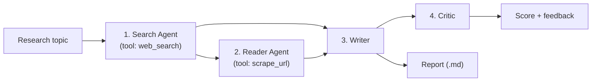

# ResearchMind: Multi-Agent AI Research Assistant

ResearchMind turns a single research topic into a structured, sourced report. Four AI components work in sequence: one searches the web, one reads the best source, one writes the report and one critiques it. The pipeline is built with **LangGraph**, **LangChain** and the **Google Gemini 2.5 Flash API**, with a **Streamlit** interface.

## How it works



| Step | Component | What it does |
|------|-----------|--------------|
| 1 | **Search Agent** (LangGraph ReAct agent) | Decides what to search for and calls the `web_search` tool, which returns the top 5 DuckDuckGo results (title, URL, snippet). |
| 2 | **Reader Agent** (LangGraph ReAct agent) | Reads the search results, picks the most relevant URL and calls the `scrape_url` tool to pull the page's full text. |
| 3 | **Writer** (LangChain prompt chain) | Combines the search results and scraped content into a report with a fixed structure: Introduction, Key Findings (at least 3), Conclusion and Sources. |
| 4 | **Critic** (LangChain prompt chain) | Reviews the report and returns a score out of 10, strengths, areas to improve and a one-line verdict. |

### Agent tools (`tools.py`)

Both tools are custom LangChain `@tool` functions, so the agents decide when to call them from the tool's name and docstring.

- **`web_search(query)`**: searches DuckDuckGo and returns the top 5 results as plain text. Errors are returned as text instead of crashing the agent.
- **`scrape_url(url)`**: downloads the page (10-second timeout), removes `script`, `style`, `nav` and `footer` tags with BeautifulSoup, and returns at most **5,000 characters** of clean text.

## Design decisions

- **Agents only where a decision is needed.** Searching and choosing a URL need the model to decide which tool to call and with what input, so those steps are ReAct agents. Writing and critiquing need no tools, so they are plain prompt chains. That makes them cheaper, faster and easier to predict.
- **Context size is controlled on purpose.** Scraped pages are capped at 5,000 characters, and the Reader sees only the first 800 characters of the search results. This keeps prompts small and the model focused on the most relevant text.
- **Output formats are fixed in the prompt.** The Writer must follow a set report structure and the Critic must answer in an exact format (`Score: X/10`, strengths, improvements, verdict). That makes outputs consistent and easy to check.
- **Tools fail softly.** Tool errors come back as text the agent can read, so one bad URL doesn't stop the whole pipeline.

## Project structure

```
Research_Agent/
├── app.py            # Streamlit UI: topic input, live pipeline status, report, critic feedback, .md download
├── pipeline.py       # Runs the 4 steps in order; also works from the command line
├── agents.py         # Gemini model setup, Search/Reader agents, Writer/Critic prompt chains
├── tools.py          # web_search and scrape_url tools
├── test_ollama.py    # Quick check that your Gemini API key works
└── requirements.txt
```

## Getting started

**Requirements:** Python 3.10+ and a Google Gemini API key (free from [Google AI Studio](https://aistudio.google.com/app/apikey)).

```bash
git clone https://github.com/SANJAY6215/Research_Agent.git
cd Research_Agent

python -m venv venv
source venv/bin/activate        # Windows: venv\Scripts\activate

pip install -r requirements.txt
```

Create a `.env` file in the project folder:

```
GOOGLE_API_KEY=your-api-key-here
```

Check the key works:

```bash
python test_ollama.py
```

## Usage

**Web app:**

```bash
streamlit run app.py
```

Enter a topic (for example *"LLM agents 2025"*) and click **Run Research Pipeline**. The pipeline panel shows each agent's status as it runs. When it finishes you can:
- read the final report and download it as a Markdown file,
- read the Critic's score and feedback,
- open the raw Search and Reader outputs to see what each agent found.

**Command line:**

```bash
python pipeline.py
```

## Known limitations

- The Reader scrapes **one** URL per run, so a report draws deeply on a single source plus search snippets.
- The Critic's feedback is shown to the user but **not sent back to the Writer**, so the report isn't revised automatically.
- Pages longer than 5,000 characters are cut off, which can drop useful content.
- With temperature 0.7, results vary between runs.
- There are no automated tests yet.

## Next steps

- [ ] Add a revision loop: if the Critic scores below a threshold, send the report back to the Writer, using a LangGraph conditional edge.
- [ ] Let the Reader scrape several sources and merge them.
- [ ] Link each key finding to the source it came from.
- [ ] Expose `web_search` and `scrape_url` as an **MCP server** so any MCP-compatible agent can use them.
- [ ] Add tests for the tools and a small evaluation set of topics.

## Tech stack

Python · LangGraph · LangChain · Google Gemini 2.5 Flash · DuckDuckGo Search · BeautifulSoup · Streamlit
